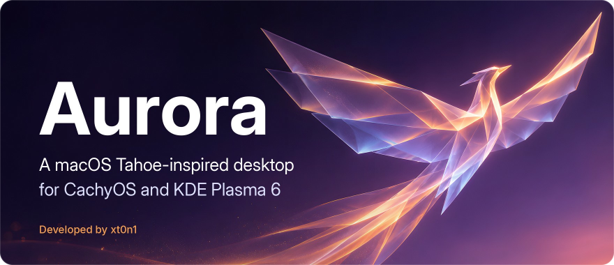
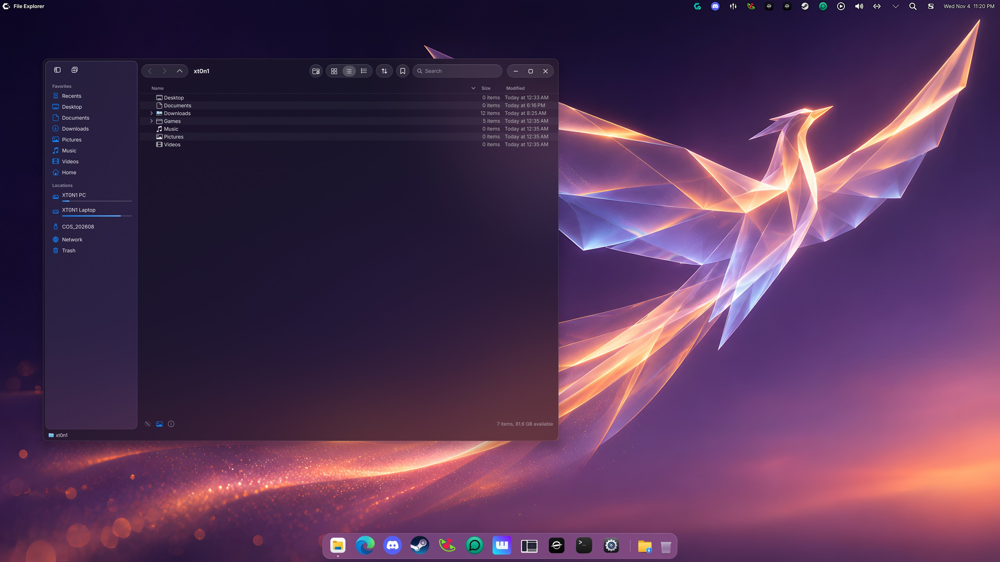
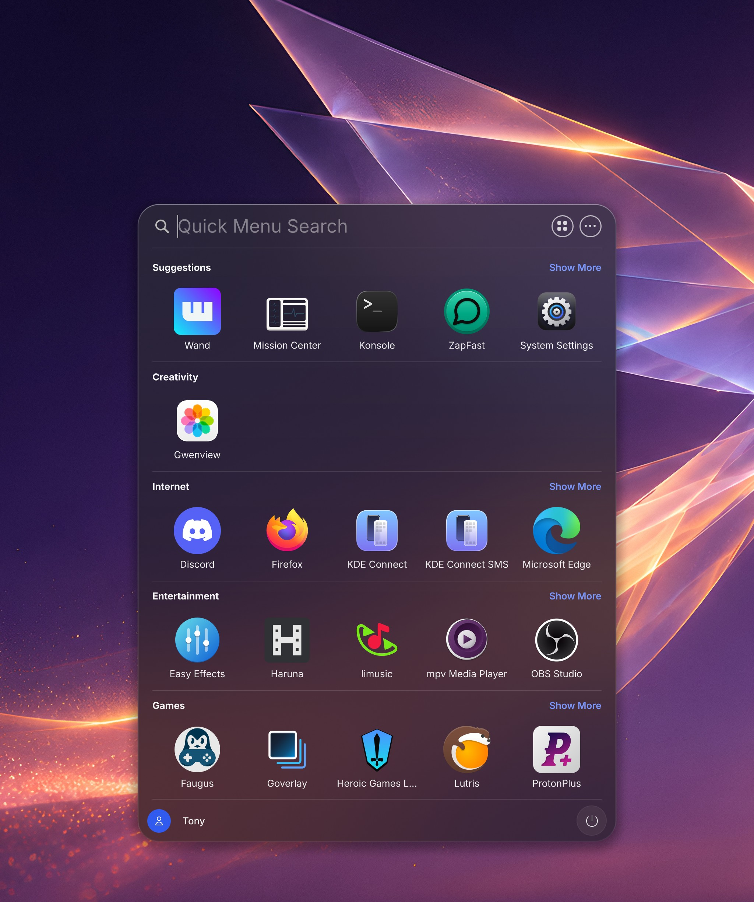
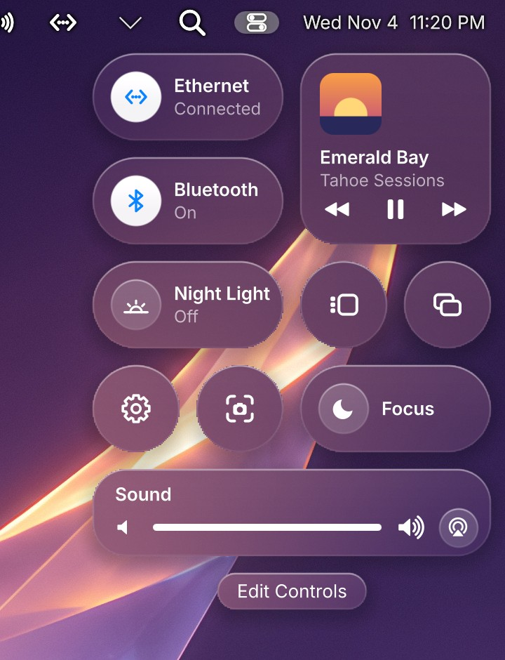
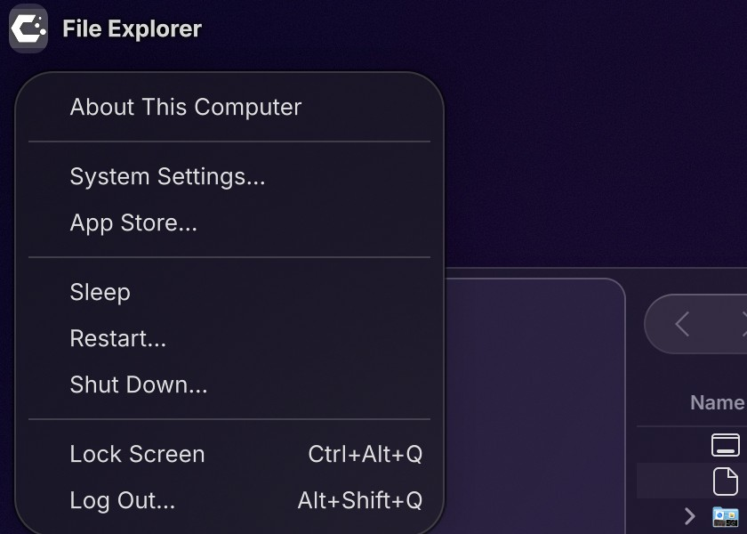
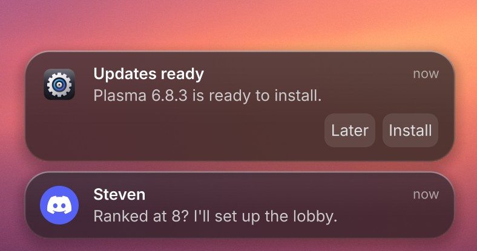
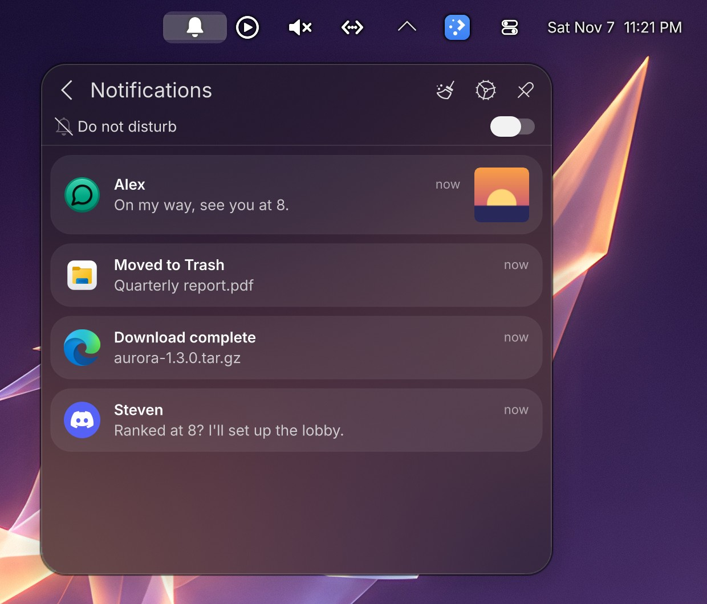
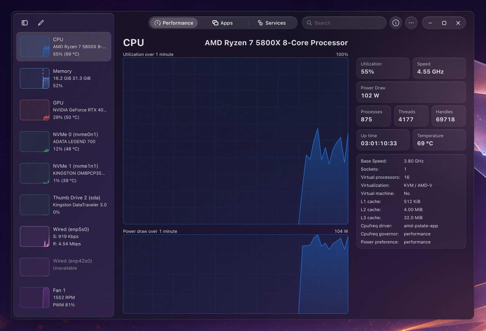
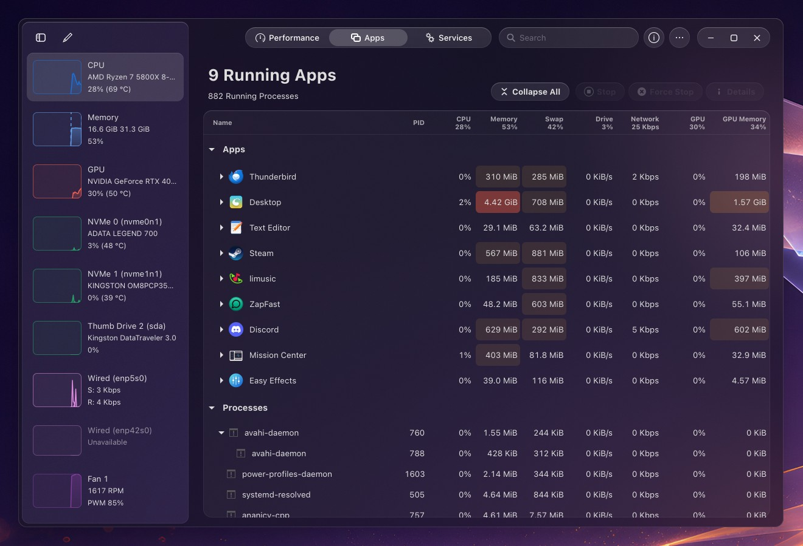
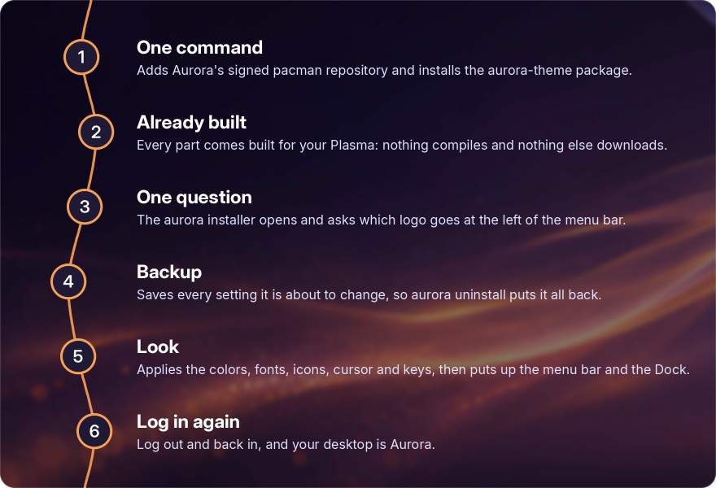

<!-- Landing page: what Aurora looks like, how to install and remove it, and what it is built from. -->
<p align="center"></p>

<h2 align="center" id="overview"></h2>

Aurora is a macOS Tahoe-inspired theme for KDE Plasma 6 on CachyOS. It is not a copy of Tahoe: it takes its look and its ideas and fits them to Plasma. You get a menu bar at the top, a Dock at the bottom, Quick Menu, the Control Center, notification banners, a Finder-style file manager and glass window buttons.

I moved from Windows 11 to CachyOS and wanted Tahoe's look without relearning my habits. So the Windows key opens Quick Menu, Win+E opens File Explorer, the window buttons are in Windows order (minimize, maximize, close) and menus show shortcuts as `Ctrl+C`.

One command installs it and one removes it. The installer saves every setting before it changes it, and `aurora uninstall` puts them back.

Nothing in KWin is patched and no file that belongs to a package is edited. Some parts are Plasma's own code rebuilt with a small patch, some are plugins that load ahead of the stock ones, some are Plasma widgets, and the rest are settings. When a system update brings a new Plasma, KWin or Qt, the parts built for the old version are skipped at login and Plasma uses its own until you rebuild them.

<h2 align="center" id="showcase"></h2>

<p align="center">
<a href="assets/screenshots/desktop.jpg"></a>
<br>File Explorer, the menu bar and the Dock on Dawn Bird, Aurora's own wallpaper (KDE Plasma 6.8.2, CachyOS).
</p>

<table>
  <tr>
    <td width="50%" align="center"><a href="assets/screenshots/quick-menu.jpg"></a><br>Quick Menu opens on the Windows key. Right-click an app to pin it to the top or to the Dock, or to take it out of Suggestions. Drag apps to reorder them inside a category.</td>
    <td width="50%" align="center"><a href="assets/screenshots/control-center.jpg"></a><br>The Control Center, opened from the switch icon in the menu bar.</td>
  </tr>
  <tr>
    <td width="50%" align="center"><a href="assets/screenshots/kali-menu.jpg"></a><br>CachyOS's logo takes the Apple logo's place. Its settings offer Arch Linux, Apple and Kali Linux too.</td>
    <td width="50%" align="center"><a href="assets/screenshots/notifications.jpg"></a><br>Notifications arrive as banners in the bottom-right corner.</td>
  </tr>
  <tr>
    <td width="50%" align="center"><a href="assets/screenshots/notification-center.jpg"></a><br>The bell opens the notifications you missed, each on its own glass card as in macOS Tahoe.</td>
    <td width="50%" align="center"><a href="assets/screenshots/mission-center.jpg"></a><br>Mission Center in File Explorer's glass, with each app's GPU, memory and network counted exactly.</td>
  </tr>
  <tr>
    <td colspan="2" align="center"><a href="assets/screenshots/mission-center-apps.jpg"></a><br>Apps and processes as in the Windows 11 Task Manager, with busy values tinted warmer as they rise.</td>
  </tr>
</table>

<h2 align="center" id="features"></h2>

| Part | What it does | Source |
| --- | --- | --- |
| File Explorer | A Finder-style file manager built on Dolphin. Click any folder of the path, drop files on it or drag it out; type a path (Ctrl+L) with suggestions and Tab; search the whole PC as you type from an index that runs only while File Explorer is used; press Space for Quick Look, F3 for Split View, and tag files with Finder's colors. The sidebar lists your drives with their free space, unfolds your folders and lists each tag's files. Win+E opens it, every app's Open and Save dialogs use it, and "Show in folder" opens it. | [`components/file-explorer`](components/file-explorer) |
| Window buttons | A glass capsule with minimize, maximize and close, in that order. Qt, GTK and libadwaita apps all get the same buttons at the same size. | [`components/window-buttons`](components/window-buttons) |
| Menu bar | The system menu under CachyOS's logo (or Arch Linux's, Apple's or Kali Linux's), the name of the active app, the tray, Quick Menu, Control Center and the clock, spaced the way macOS spaces them. There is no global menu. | [`components/kali-menu`](components/kali-menu), [`components/clock`](components/clock), [`themes/panels`](themes/panels) |
| System tray | Plasma's tray, with drag and drop like Windows 11: drag an icon to move it, or drop it on the arrow to hide it. | [`components/system-tray`](components/system-tray) |
| Quick Menu | The Windows key opens Tahoe's Applications view: the apps you use most, then every app by category. Right-click an app (or press the Menu key) to pin it to the top or to the Dock, or to take it out of Suggestions. Drag an app onto another one in the same category to move it there; the order is kept. All Applications lists every app by letter. Start typing to search with KRunner. The rail at the bottom works like Windows 11's Start: your picture and name open Lock, Switch User and Log Out, and the power button opens Sleep, Restart and Shut Down. | [`components/quick-menu`](components/quick-menu), [`components/windows-key`](components/windows-key) |
| Control Center | Network, Bluetooth, Focus, sound and its output devices, the player, Night Light, screen mirroring, settings and screenshots. | [`components/control-center`](components/control-center), [`components/glass`](components/glass) |
| Notifications | Banners with the app icon, a bold title, the text and the action buttons, in the bottom-right corner. The bell in the menu bar lists what you missed on glass cards, with Do not disturb at the top. | [`components/notifications`](components/notifications) |
| Dock | Your pinned apps, a divider, Downloads and Trash. It moves out of the way of windows that reach it; touch the bottom edge to bring it back. | [`components/dock-divider`](components/dock-divider), [`themes/panels`](themes/panels) |
| Animations | Windows open, close and minimize into the Dock the way macOS does it, at Plasma's designed speed; `aurora settings` makes them faster or turns them off. | [`components/motion`](components/motion) |
| Pointer | macOS cursors, and a pointing hand over anything you can click, KWin's window buttons included. | [`components/pointing-hand`](components/pointing-hand), [`themes/cursors`](themes/cursors) |
| Mission Center | Optional, with `aurora mission-center on`: Mission Center in File Explorer's glass, with each app's GPU, memory and network counted exactly, a lean background service and a color per device. Apps and Services read like the Windows 11 Task Manager. | [`components/mission-center`](components/mission-center) |
| Energy page | A page in Info Center that shows the CPU and GPU power draw, a two-minute chart and the power profiles. | [`components/energy-page`](components/energy-page) |
| Themes | Dawn Bird, Aurora's own wallpaper; Aurora's colors, Plasma style, Kvantum and GTK themes, cursors and icons with each app's own logo, the Inter font (or SF Pro, if you installed it) and a Konsole profile. | [`themes`](themes) |

<h2 align="center" id="requirements"></h2>

| | |
| --- | --- |
| System | CachyOS, or another Arch-based distribution with pacman |
| Processor | Any 64-bit x86 processor (x86-64), old or new |
| Desktop | KDE Plasma 6 on Wayland. Tested on Plasma 6.8.2, KWin 6.8.2 and Qt 6.12.0. |
| Disk | About 700 MB for the build: the `build/` folder of a checkout, or `~/.cache/aurora/build` with the package |
| Time | Under a minute with the package, which comes with its parts built; about 3 minutes from the source, which builds them |

<h2 align="center" id="installation"></h2>

One command, as yourself (not with sudo), in bash, zsh or fish:

```bash
curl -fsSL https://raw.githubusercontent.com/xt0n1-t3ch/Aurora-CachyOS-Theme/main/get.sh | bash
```

It adds Aurora's signed pacman repository, installs the `aurora-theme` package and opens `aurora install`. The only question is which logo goes in the menu bar. Your password is asked once. Log out and back in when it finishes.

<p align="center"></p>

From then on, everything goes through the `aurora` command. Run it alone for a menu, or name what you want:

| Command | What it does |
| --- | --- |
| `aurora` | A menu with everything below |
| `aurora install` | The guided install; `--logo`, `--colors`, `--performance` and `--yes` answer its questions up front |
| `aurora update` | Installs a new Aurora the safe way: with your system update when it is built for it, alone when it is built for your system as it is, not at all otherwise |
| `aurora rebuild` | Builds Aurora's parts again after a Plasma, KWin or Qt update |
| `aurora settings` | Update notices, animations, the menu bar logo, icons, performance tuning and Mission Center, in one menu |
| `aurora logo arch` | Changes the menu bar logo: `cachyos`, `arch`, `apple` or `kali`; `--colors` shows it in its own colors |
| `aurora icons breeze` | Changes the icon theme: `aurora` or any installed one; without a name it lists them |
| `aurora performance on` | Turns the measured tuning on or `off`; without a word it shows the four settings and asks |
| `aurora backups` | Lists the backups of your desktop from before Aurora; `aurora backups restore` puts one back |
| `aurora mission-center on` | Puts Aurora's Mission Center (exact per-app GPU, memory and network) in place of the distribution's, or `off`; `settings`, `snapshots` and `rollback` too |
| `aurora check-updates` | Looks for a newer Aurora right away |
| `aurora status` | What is installed, from where, whether Aurora's repository is set up, the tuning, and whether a rebuild is due |
| `aurora uninstall` | Puts your desktop back the way it was |

Aurora also tells you when a new version is out: a notification with **Update now** and **Skip this version**, once a day or on the schedule you pick in `aurora settings`.

<details>
<summary>What the one command does</summary>

[`get.sh`](get.sh) runs these steps; the first two happen once.

1. Trusts Aurora's signing key, [`aurora.asc`](packaging/repo/aurora.asc) (`657D 8110 799A 4E65 BE4E 1AB4 F028 2841 1279 4CC2`), after checking that the downloaded key has that fingerprint.
2. Adds the `[aurora]` section to `/etc/pacman.conf`. The repository is this project's [`repo` release](https://github.com/xt0n1-t3ch/Aurora-CachyOS-Theme/releases/tag/repo), and every file in it is signed.
3. Upgrades the system with the package, `sudo pacman -Syu aurora-theme`. The package brings every part already built, so nothing is compiled on your machine.
4. Opens `aurora install`, which saves your current settings to `~/.local/state/aurora/backups/`, applies the theme and keeps a log in `~/.local/state/aurora/logs`.

</details>

<details>
<summary>Installing from the source instead</summary>

```bash
git clone https://github.com/xt0n1-t3ch/Aurora-CachyOS-Theme.git
cd Aurora-CachyOS-Theme
./install.sh
```

The script installs the packages it needs, builds the parts for your version of Plasma, saves your current settings and applies the theme. It installs the `aurora` command too when Rust is installed, and from then on the commands above work the same. Every [release](https://github.com/xt0n1-t3ch/Aurora-CachyOS-Theme/releases) also has an `aurora-X.Y.Z.tar.gz` to install without git. `./install.sh --help` lists its options.

</details>

<details>
<summary>What changes outside your home folder</summary>

| Path | Why | Removed by |
| --- | --- | --- |
| `/usr/lib/qt6/plugins/org.kde.kdecoration3/org.aurora.decoration.so` | A link to the window buttons in your home folder, since KWin loads decorations before your session starts | `aurora uninstall` |
| `/usr/lib/qt6/plugins/kwin/plugins/aurora-pointer.so` | A link to the pointing hand for window buttons, for the same reason | `aurora uninstall` |
| `/etc/scx_loader.toml`, `/etc/tmpfiles.d/thp.conf`, `/etc/sysctl.d/99-aurora-memory.conf`, `/etc/systemd/zram-generator.conf.d/90-aurora-zram.conf` | Only with the performance tuning | `aurora performance off` or `aurora uninstall` |

Everything else goes in your home folder. [docs/architecture.md](docs/architecture.md) has the full list.

</details>

<h2 align="center" id="keyboard-shortcuts"></h2>

| Keys | What it does |
| --- | --- |
| <kbd>Win</kbd> | Opens Quick Menu. Press it again or <kbd>Esc</kbd> to close it. |
| <kbd>Alt</kbd>+<kbd>Space</kbd> | Also opens Quick Menu |
| <kbd>Win</kbd>+<kbd>E</kbd> | Opens File Explorer |
| <kbd>Win</kbd>+<kbd>L</kbd> | Locks the screen (Plasma's default) |
| <kbd>Ctrl</kbd>+<kbd>Alt</kbd>+<kbd>Del</kbd> | Opens the log out screen (Plasma's default) |

All of Plasma's other shortcuts work as before. Menus write them the Windows way, like `Ctrl+C`, not with Mac symbols.

<h2 align="center" id="updating"></h2>

### A new version of Aurora

```bash
aurora update
```

It updates your system and the `aurora-theme` package together (through paru or yay if you have one, else `sudo pacman -Syu`), then installs the new version. It keeps your backup, your logo, your menu bar, your Dock and the tuning. From a source copy it pulls the newest commits instead. [CHANGELOG.md](CHANGELOG.md) lists what changed in each version.

### After a system update

The system tray, the notifications, Quick Menu and the window buttons are compiled for the exact versions of Plasma, KDecoration and Qt you have. If an update changes one of them, those parts are set aside at the next login and Plasma's own versions load instead. Nothing breaks; those parts look like stock Plasma until you rebuild them:

```bash
aurora rebuild
```

Then log out and back in. `aurora status` says whether a rebuild is due. If a new Plasma changes the lines a patch touches, [docs/update.md](docs/update.md) explains how to port it.

<h2 align="center" id="performance-tuning"></h2>

```bash
aurora performance on     # and off to go back to CachyOS's settings
```

Four system settings, each measured on a Ryzen 7 5800X with 32 GB of RAM before I kept it. They are optional; `aurora performance` alone shows whether they are on and asks, and `aurora install --performance` adds them during the install.

| Setting | What I measured |
| --- | --- |
| scx_lavd CPU scheduler, Auto mode | With 32 busy threads in the background, the emoji picker opened in 666 ms instead of 1099 ms and Konsole in 674 ms instead of 819 ms. 7-Zip scored 101k to 108k MIPS instead of 96k to 97k. |
| `vm.watermark_scale_factor = 125` | Direct-reclaim stalls dropped from about 1,560 every 15 minutes to zero. It keeps about 400 MB free. |
| lz4 compression for zram | Swapped-out pages load 2.8 times faster: 3.7 GB/s instead of 1.3 GB/s. It starts at the next boot. |
| Transparent huge pages set to `defer` | Huge pages are put together in the background instead of making the app wait. Before the change I counted 279,000 of those waits. |

[docs/performance.md](docs/performance.md) has the numbers, the scripts that produced them, and what I tried and dropped.

<h2 align="center" id="dependencies"></h2>

### Core projects

| Project | Used for | Version | License |
| --- | --- | --- | --- |
| [Plasma Workspace](https://invent.kde.org/plasma/plasma-workspace) by KDE | The system tray, notifications and KRunner, each rebuilt with a patch | 6.8.2 | GPL-2.0-or-later |
| [Dolphin](https://invent.kde.org/system/dolphin) by KDE | The file view inside File Explorer, loaded at run time | installed version | GPL-2.0-or-later |
| [Inter](https://rsms.me/inter/) by Rasmus Andersson (`inter-font`) | The interface font, and the text of the pictures on this page | 4.1 | OFL-1.1 |
| [JetBrains Mono](https://www.jetbrains.com/lp/mono/) with [Nerd Fonts](https://www.nerdfonts.com) symbols (`ttf-jetbrains-mono-nerd`) | Konsole's font | 3.5.1 | OFL-1.1 |

### System packages

[`install.sh`](install.sh) installs these with pacman if they are missing. The list is in [`installer/dependencies.txt`](installer/dependencies.txt), and a test checks that the build and the installer don't use anything that isn't on it.

| Group | Packages |
| --- | --- |
| Build tools | `base-devel` `git` `cmake` `ninja` `extra-cmake-modules` `vulkan-headers` |
| Qt 6 | `qt6-base` `qt6-declarative` `qt6-shadertools` `qt6-svg` `qt6-tools` `qt6-5compat` |
| KDE Frameworks 6 | `kconfig` `kcoreaddons` `kcrash` `kdbusaddons` `kglobalaccel` `ki18n` `kiconthemes` `kio` `kitemmodels` `kjobwidgets` `knotifications` `kparts` `kpackage` `krunner` `kservice` `kstatusnotifieritem` `kwindowsystem` `kxmlgui` `kcmutils` `solid` `kirigami` `kirigami-addons` `kdeclarative` `ksvg` `kquickcharts` |
| Plasma 6 | `plasma-workspace` `plasma-activities` `libplasma` `kwin` `kdecoration` `layer-shell-qt` `wayland` `dolphin` `kinfocenter` `xdg-desktop-portal` `xdg-desktop-portal-kde` `plasma5support` `milou` `plasma-nm` `plasma-pa` `bluez-qt` `powerdevil` |
| Look and session | `kvantum` `dconf` `xsettingsd` `fontconfig` `inter-font` `ttf-jetbrains-mono-nerd` `systemd` `dbus` `python` `python-pillow` |
| Performance tuning | `scx-scheds` `scx-tools`, only with `--performance` |

<h2 align="center" id="removal"></h2>

```bash
aurora uninstall
```

This removes everything Aurora installed and puts back every setting the install saved before changing it: colors, icons, fonts, panels, shortcuts, window buttons, Quick Menu, the default file manager, the two links and the tuning. Log out and back in afterwards.

The backup stays in `~/.local/state/aurora/backups/`. `aurora backups` lists what is there and when each was taken, and `aurora backups restore NAME` puts a particular one back. From a source copy, `./uninstall.sh` does the same as `aurora uninstall`.

<h2 align="center" id="project-structure"></h2>

```text
get.sh          the one-command install: the pacman repository, the package, then aurora
install.sh      installs Aurora: packages, build, backup, files, look
uninstall.sh    restores the desktop from the backup install.sh made
LICENSE         the GNU GPL version 3
NOTICE.md       the attribution terms, and which license covers each part
CHANGELOG.md    what changed in each version
CITATION.cff    how to credit Aurora (GitHub's "Cite this repository")
llms.txt        a map of these documents for coding agents (llms-full.txt: all of them)
components/     one folder per part: file-explorer, window-buttons, quick-menu,
                system-tray, notifications, control-center, kali-menu, clock,
                dock-divider, glass, pointing-hand, energy-page, windows-key
cli/            the aurora command (Rust)
themes/         Dawn Bird (the wallpaper), icons, cursors, fonts, GTK, Konsole,
                and the menu bar and Dock layout
installer/      build.sh, install.py, the package list, session files, desktop entries
packaging/      the package aurora-theme and the repository's key
performance/    the optional system tuning, and the scripts that measured it
scripts/        check.sh runs every test; release.sh makes a release; the license,
                llms.txt and GitHub metadata tools
tests/          installer and release tests, and a sandbox that runs Plasma in a window
docs/           how each part works, and how to build, update, restore, test and release
assets/         the logo, the pictures on this page and the social preview
```

<h2 align="center" id="development"></h2>

Start with [docs/index.md](docs/index.md) for how each part works, and [tests/index.md](tests/index.md) for the tests. Coding agents and language models can start from [llms.txt](llms.txt), the map of these documents, or read all of them at once in [llms-full.txt](llms-full.txt).

```bash
installer/build.sh            # build every part into build/
scripts/check.sh              # build, then run every test (about 25 seconds after a build)
python3 -I scripts/llms.py    # write llms.txt and llms-full.txt again after a change to the docs
tests/sandbox/run.sh "$PWD/tests/sandbox/scenarios/quick-menu.sh" 120   # one scenario in a nested Plasma
```

Versions follow [Semantic Versioning](https://semver.org/spec/v2.0.0.html), the changelog follows [Keep a Changelog](https://keepachangelog.com/en/2.0.0/), and commit messages follow [Conventional Commits](https://www.conventionalcommits.org/en/v1.0.0/). To make a release, run `scripts/release.sh 1.2.0`. It runs the checks, dates the changelog, tags `v1.2.0` and builds the archive with its notes and checksums. [docs/releasing.md](docs/releasing.md) has the details.

<h2 align="center" id="faq"></h2>

### Will a Plasma update break my desktop?

No. Each compiled part records the versions it was built for. At login, a part built for different versions is skipped and Plasma loads its own instead; Quick Menu falls back to the stock KRunner. Run `aurora rebuild` to get Aurora's parts back.

### Does it change system files?

It adds two symbolic links in `/usr/lib/qt6/plugins`, and four files in `/etc` if you turn on the performance tuning. It doesn't edit any file that belongs to a package, and `aurora uninstall` removes all of them.

### Can I use Apple's SF Pro font?

Yes. Aurora ships only free fonts, because Apple's license doesn't allow SF Pro to be redistributed. Install it yourself (for example `paru -S apple-fonts`, which downloads it from Apple) and run `aurora update` again: when SF Pro or SF Mono with Nerd Fonts' symbols is installed, Aurora uses it instead of Inter and JetBrains Mono.

### Do I keep my wallpaper and pinned apps?

Yes. Your wallpaper stays; Dawn Bird, Aurora's own wallpaper, is only added to the list. Apps pinned to your task manager move to the Dock, after File Explorer.

### Does it work on X11?

I only use and test it on Wayland, which is CachyOS's default. X11 is untested.

### Can I try it without touching my desktop?

Yes. [`tests/sandbox`](tests/sandbox) runs a full Plasma session inside a window with its own home folder. [docs/sandbox.md](docs/sandbox.md) explains how to use it.

<h2 align="center" id="license"></h2>

Aurora is made by [xt0n1](https://github.com/xt0n1-t3ch). Its own code is free software under the [GNU GPL version 3](LICENSE), with [additional terms](NOTICE.md): you can use it, change it and share it, as long as the author attribution stays and a modified version says it is based on Aurora instead of passing as the original.

The parts that come from other projects keep their licenses: Plasma's parts are GPL-2.0-or-later, and every other project keeps its own license. Dawn Bird and the pictures on this page are CC BY-SA 4.0: share and adapt them, crediting xt0n1. [NOTICE.md](NOTICE.md) lists which license covers what, and `aurora license` shows the terms.
